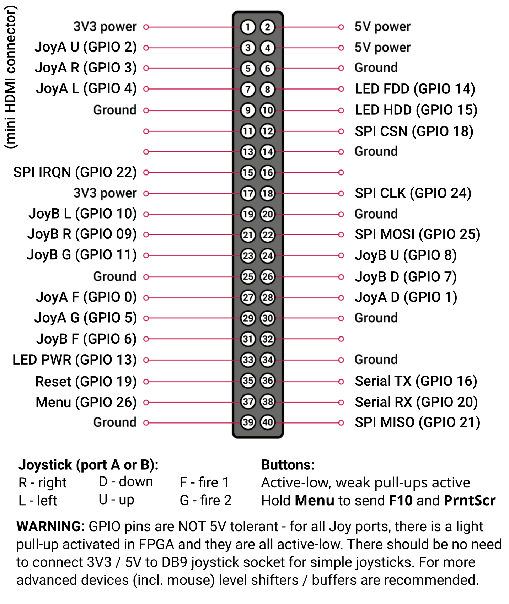

# Minimig AGA
Ported to IcePi Zero and FleaFPGA Ohm

For support, join [Icy Electronics Discord](https://discord.gg/vzrqfhcvWr). Then open [#minimig channel](https://discord.com/channels/1381526195925024780/1529492140198199479).

### Foreword

[minimig](http://en.wikipedia.org/wiki/Minimig) (short for Mini Amiga) is an open source re-implementation of an Amiga using a field-programmable gate array (FPGA). Original minimig author is Dennis van Weeren.

[Amiga](http://en.wikipedia.org/wiki/Amiga_500) was an amazing personal computer, announced around 1984, which - at the time - far surpassed any other personal computer on the market, with advanced graphic & sound capabilities, not to mention its great OS with preemptive multitasking capabilities.

This minimig variant has been upgraded with [AGA chipset](http://en.wikipedia.org/wiki/Amiga_Advanced_Graphics_Architecture) capabilites, which allows it to emulate the latest Amiga models ([Amiga 1200](http://en.wikipedia.org/wiki/Amiga_1200), [Amiga 4000](http://en.wikipedia.org/wiki/Amiga_4000) and (partially) [Amiga CD32](http://en.wikipedia.org/wiki/Amiga_CD32)). Ofcourse it also supports previous OCS/ECS Amigas like [Amiga 500](http://en.wikipedia.org/wiki/Amiga_500), [Amiga 600](http://en.wikipedia.org/wiki/Amiga_600) etc.

## Core features supported

* chipset variants : OCS, ECS, AGA
* chipRAM : 0.5MB - 2.0MB
* slowRAM : 0.0MB - 1.5MB
* fastRAM : 0.0MB - 24MB
* CPU core : 68000, 68010, 68020
* kickstart : 1.2 - 3.2 (256kB, 512kB & 1MB kickstart ROMs currently supported)
* floppy disks : 1-4 floppies (supports ADF floppy image format), with normal & turbo speeds
* hard disks : 1-2 hard disk images (supports whole disk images, partition images, using whole SD card and using SD card partition)
* optional IDE CD-ROM with ISO / CUE mounting and disc changes without rebooting
* video standard : PAL / NTSC
* supports HDMI video output with sound
* peripherals : 2 x USB HID ports with FPGA USB controllers
* has an implementation of the [Akiko](https://en.wikipedia.org/wiki/Amiga_custom_chips#Akiko) chunky to planar converter
* RTG framebuffer video with a Picasso96 driver and independent 1x / 2x / 3x / 4x horizontal and 1x / 2x / 3x vertical pixel repetition

## RTG video (Picasso96)

RTG uses a framebuffer in Fast RAM and a fixed HDMI raster selected in the board top file. The current raster is 1024x768, with a 66 MHz pixel clock on IcePi Zero/XL and on FleaFPGA Ohm. Smaller source modes use pixel repetition; the physical HDMI timing stays the same. Native Amiga video is selected at boot and works without the RTG driver. RTG is enabled when Picasso96 requests it.

Use an FPGA build with RTG support, the matching `minimig.card` driver, a 68020 CPU configuration and enough Fast RAM for both RTG and AmigaOS. The driver reserves 4 MiB by default, reducing its reservation if allocation fails. The optional `VIDEOMEMORY` monitor tooltype can request a different amount.

### Building the RTG driver

On Linux, install GNU make 4.3 or newer, bash, curl, 7z, Python 3, and `xdftool` from amitools. The `vasmm68k_mot` assembler must already be installed; its default location is `~/vbcc/bin/vasmm68k_mot`.

Run from the repository root:

```sh
make -C amiga_sw/rtg
```

Missing Amiga NDK and public/private P96 headers are downloaded automatically into `amiga_sw/rtg/.deps` and reused by subsequent builds. The assembler is not downloaded. To use another vbcc installation, pass `VBCC=/path/to/vbcc` to make.

The build produces these files in `amiga_sw/rtg/`:

* `minimig.card` - the Amiga driver library.
* `minimig.card.lst` - the 1024x768 assembler listing.
* `minimig-720p.card` and `minimig-720p.card.lst` - the 1280x720 driver and listing.
* `rtgcheck` - a read-only board/driver diagnostic.
* `minimig-rtg.adf` - the 1024x768 transfer floppy, volume `MinimigRTG`.
* `minimig-rtg-720p.adf` - the 1280x720 transfer floppy, volume `MinimigRTG720p`.

Gateware for 720p is not yet provided, so stick to regular `minimig-rtg.adf`.

Both ADFs are 880 KiB OFS images containing the matching driver as
`Libs/Picasso96/minimig.card`, the diagnostic and driver README. Every normal
build produces both profiles.

Serial debug logging is disabled by default. Build with `make -C amiga_sw/rtg DEBUG=1` to enable it, or `DEBUG=0` to disable it again. Changing this option rebuilds the driver and ADF without requiring `make clean`.

Run the driver callbacks on the simulated TG68K/RTG core with
`make -C amiga_sw/rtg test`. Both raster profiles are checked; see
[driver test coverage and requirements](amiga_sw/rtg/tests/README.md).

### Installing the RTG driver

1. Install Picasso96 on the Amiga. The driver works with P96 2.0. If the installer requires a board choice, select PicassoIV to obtain a monitor executable.
2. Mount `amiga_sw/rtg/minimig-rtg.adf` and copy the matching driver from an Amiga Shell:

   ```text
   Copy MinimigRTG:Libs/Picasso96/minimig.card LIBS:Picasso96/minimig.card
   ```

3. Rename the installed monitor executable and its icon from `DEVS:Monitors/PicassoIV` and `PicassoIV.info` to `DEVS:Monitors/Minimig` and `Minimig.info`. The monitor executable comes from the P96 installer.
4. Open the Minimig monitor icon's Information window and set the tooltype `BOARDTYPE=minimig`. Optionally add `VIDEOMEMORY=<n>`, where `n` is the requested reservation in MiB, from 1 to 7.
5. Reboot, open Picasso96Mode, attach a setting to the Minimig board and create modes from the table below. Test them before saving. Select a tested Workbench mode in `Prefs:ScreenMode`.

Picasso96Mode settings provide the mode list; modes are not stored in the FPGA or installed automatically by the `.card` driver. The ADF is a transfer disk; Picasso96 must be installed separately. Run `MinimigRTG:rtgcheck` to inspect the RTG ID/status, available Fast RAM and installed driver without changing video modes.

### Supported RTG modes

Driver 1.15 programs a viewport within the fixed HDMI raster. It selects the largest independent horizontal (1x–4x) and vertical (1x–3x) repetition factors that fit, with black borders outside the image. All combinations support CLUT, RGB565 and RGB555.

| Physical raster | Aligned source widths at 1x / 2x / 3x / 4x | Aligned source heights at 1x / 2x / 3x |
| --- | --- | --- |
| 1024x768 | 1024 / 512 / 336 / unavailable | 768 / 384 / 256 |
| 1280x720 | 1280 / 640 / 416 / 320 | 720 / 352 / 240 |

The minimum source mode is **320x192**; 4x horizontal repetition therefore requires the 1280x720 profile. These are maximum aligned dimensions for each factor, rather than a fixed mode list. Smaller modes work too: 320x240 uses 3x3 repetition at 1024x768, or 4x3 at 1280x720. Viewport boundaries use 16-pixel units; borders are centered to that alignment, with any unmatched block on the right or bottom.

### RTG limitations and fallback modes

* Install driver 1.15 with the matching core. The driver must program explicit stride; configuration registers are write-only.
* Visible source dimensions must be multiples of 16. For other sizes, the driver crops the visible width/height down to that alignment while preserving the full bitmap stride. For example, 1280x360 displays 1280x352 at 1x2 in 720p, leaving 16 output lines of border below.
* Source widths below 320, heights below 192, or dimensions above the selected physical raster cannot enable RTG scanout. Editor clock callbacks still return defined, nonzero timing values.
* Horizontal panning is unsupported. Dragged screens must share pixel format and repetition settings. Split positions retain single-output-line precision in hardware.
* Vertical repetition rereads every displayed row from SDRAM; there is no full-line replay buffer.
* Rendering uses the CPU; the driver provides no hardware blitter or hardware sprite acceleration. Double buffering is controlled by the application through P96.

See [the driver README](amiga_sw/rtg/README) for additional details and version history.

## USB support

Please keep in mind that the board is FPGA-based, and the USB HID controller is implemented in gateware. There is no dedicated USB controller chip on the board itself. As a result, some USB HID devices may not be compatible with the board.

I have tested the following devices and can confirm they work properly:
- 8BitDo Pro 3 utilizing bundled 2.4G wireless dongle
- 8BitDo Ultimate 2C wireless utilizing bundled 2.4G wireless dongle (non-Bluetooth version)
- Logitech, Inc. Unifying Receiver w/ Y-R0012
- Logitech, Inc. Unifying Receiver w/ K400r
- SpeedLink COMPETITION PRO Extra USB Joystick
- Legacy Logitech low-speed mouse
- IBM Corp. NetVista Full Width Keyboard
- Keychron C3 Pro
- Keychron K2

Not working:
- 8BitDo 8BitDo Retro Keyboard Receiver (2dc8:5201)
- 8BitDo 8BitDo Retro 87 Adapter X (2dc8:202e)

The 8BitDo retro keyboard does not send report events even after successful enumeration. It appears the keyboard exposes two interfaces (mouse + keyboard), and both must be enumerated before reports start being received. There are also reports that this keyboard supports only NKRO and not 6KRO, despite BOOT protocol support (typically associated with 6KRO) being required by the HID standard. Further work may be done to add support for this keyboard, but no guarantees can be made given the extent of changes that may be required.

Other low-speed and full-speed USB 2.0 HID devices should generally work as well. However, avoid composite devices that include built-in USB hub or keyboard + mouse functionality. Each port supports only a single device, as it has a separate USB soft controller attached to it.

## Usage

To name configuration slots in Load/Save, add `MINMGAA.TXT` to the SD-card root, then restart:

```ini
0=Default A500
1=A1200 Workbench
2=A500 Games
3=CD32
4=Diagnostics
```

Use `slot=title`, where slot `0` is Default and `1`–`4` are numbered slots. Titles support up to 63 ASCII characters; long selected titles scroll after a short pause. Unnamed slots show `0: Default` or `N: Configuration slot N`. Unused slots show `(empty)`. The Misc page shows the active configuration.

### Hardware

To use this Minimig core, you will at the minimum need an SD/SDHC card, formatted with the FAT32 filesystem, USB HID keyboard / mouse and a HDMI monitor / TV.

IcePi Zero and IcePi Zero XL cores are compatible with the [IcePi Carrier](https://github.com/MiSTle-Dev/Boards/tree/main/icepi_carrier) board so you can use more USB ports or have better USB compatibility. The core only receives HID reports over SPI from FPGA Companion firmware. See [companion board SPI wiring](#companion-board-spi-wiring) for the regular and alternative connections.

FleaFPGA Ohm core retains original [pin assignments](https://github.com/Basman74/Minimig_ECS/blob/master/Minimig_setup_README.pdf) except for analog audio and 30/15kHz video output select. Ping me if you need IcePi carrier-compatible build.

### Installing from binary release for IcePi Zero

* download latest release from GitHub
* copy `832OSDU0.bin` file to root directory of your SD card
* flash bitstream to flash memory using openFPGALoader
```
$ openFPGALoader -b icepi-zero --write-flash fpga/icepi-zero/Minimig_IcePi-Zero/minimig_icepi-zero_Minimig_IcePi-Zero.bit
```
* alternatively, use web flasher available here http://ofl.trabucayre.com/ - Chrome works best, for Windows use Zadig (https://zadig.akeo.ie/) to install WinUSB driver
* don't forget to place kickstart ROM of your choosing on the root of the SD card (these are still copyrighted, so either copy the ROM from your real Amiga, or buy AmigaForever)
* place some ADF (floppy disk images) of your favourite games / demos / programs on your SD card
* optionally place minimig.bal, minimig.art & minimig.cop files on the root of your SD card for a nice bootup animation
* enjoy minimig! :)

### Installing from binary release for FleaFPGA Ohm

* download latest release from GitHub
* copy `832OSDU0.bin` file to root directory of your SD card
* refer to original instructions in the [FleaFPGA-JTAG flasher repository](https://github.com/XarkLabs/FleaFPGA-JTAG) on how to flash bitstream

### Building minimig-mist from sources

* checkout the source 
* download / install [Lattice Diamond](https://www.latticesemi.com/en/Products/DesignSoftwareAndIP/FPGAandLDS/LatticeDiamond)
* compile firmware and prepare boot ROM
```
$ git submodule update --init
$ cd fw
$ make
```
* copy `832OSDU0.bin` file to root directory of your SD card
* build the core using Lattice Diamond GUI (project file in fpga/icepi-zero/ or fpga/fleaohm/)
* for IcePi Zero flash bitstream to flash memory using openFPGALoader
```
$ openFPGALoader -b icepi-zero --write-flash fpga/icepi-zero/Minimig_IcePi-Zero/minimig_icepi-zero_Minimig_IcePi-Zero.bit
```
* for FleaFPGA Ohm open XCF file in Diamond from File List, right click on first row, Device Properties, pick bit file and click Load from file button and **save XCF file**, then:
```
diamond/3.14/bin/lin64/ddtcmd -oft -fullvme -if fpga/fleaohm/Minimig_FleaOhm/Minimig_FleaOhm.xcf  -nocompress -noheader -of fpga/fleaohm/Minimig_FleaOhm/Minimig_FleaOhm.vme
```
* for FleaFPGA Ohm flash .vme according to instructions from [FleaFPGA-JTAG flasher repository](https://github.com/XarkLabs/FleaFPGA-JTAG)
* don't forget to place kickstart ROM of your choosing on the root of the SD card (these are still copyrighted, so either copy the ROM from your real Amiga, or buy AmigaForever)
* place some ADF (floppy disk images) of your favourite games / demos / programs on your SD card
* optionally place minimig.bal, minimig.art & minimig.cop files on the root of your SD card for a nice bootup animation
* enjoy minimig! :)

### Wiring diagram for IcePi Zero



### Companion board SPI wiring

IcePi Zero and IcePi Zero XL support two companion board SPI layouts. GPIO numbers below follow Raspberry Pi GPIO numbering; physical pin numbers refer to the 40-pin header. Connect the companion's SPI outputs to the selected inputs below and connect a common ground. Signals use 3.3 V logic.

| Signal from companion to FPGA | Regular wiring | Alternative wiring |
| --- | --- | --- |
| SPI clock (SCLK) | GPIO24, pin 18 | GPIO11, pin 23 |
| SPI chip select (CSN, active low) | GPIO18, pin 12 | GPIO8, pin 24 |
| SPI data (MOSI) | GPIO25, pin 22 | GPIO10, pin 19 |
| Layout select | GPIO17, pin 11: low or unconnected | GPIO17, pin 11: pulled high to 3.3 V |

Regular wiring is the default: GPIO17 has an internal pull-down. It matches the SPI clock, chip-select and MOSI connections in the diagram above and leaves the joystick pins available.

For alternative wiring, pull **GPIO17 (physical pin 11) high** and keep it high while using that layout. This places SCLK, CSN and MOSI on the same header pins as a regular Raspberry Pi's default SPI0 signals (GPIO11/SCLK, GPIO8/CE0 and GPIO10/MOSI). These pins normally serve joystick B's second fire button, up and left respectively, so those three physical joystick inputs are unavailable in this layout.

The FPGA acts as an SPI receiver and only accepts HID reports from the companion. MISO and IRQ are unused by this core and do not need connecting, even though the diagram labels them. In the alternative layout, GPIO9 (pin 21), normally Raspberry Pi SPI0 MISO, remains joystick B's right input; leave it disconnected from the companion's SPI interface.

### Wiring diagram for FleaFPGA Ohm

Please refer to documentation hosted in [FleaFPGA - Minimig repository](https://github.com/Basman74/Minimig_ECS).

### Additional remarks

You will also need a Kickstart ROM image file, which you can obtain by copying Kickstart ROM IC from your actual Amiga, or by buying an [Amiga Forever](http://www.amigaforever.com/) software pack. The Kickstart image should be placed on the root of the SD card with the name KICK.ROM. Minimig also supports the [AROS](http://aros.sourceforge.net/) Kickstart ROM replacement.

The minimig can read any ADF floppy images you place on the SD card. I recommend at least Workbench 1.3 or 3.1 (AmigaOS), some of the Amigas great games (I recommend Ruff'n'Tumble) or some of the amazing demos from the vast Amiga demoscene (like State of the Art from Spaceballs).

The minimig can also use HDF harddisk images, which can be created with [WinUAE](http://www.winuae.net/).

### CD-ROM images (ISO / CUE)

One IDE slot can be configured as an optional **CD-ROM** in **Storage / IDE**.
Apply the device configuration and reset once, then use the slot's image menu to
**Insert ISO / CUE** or **Eject**. Discs can be inserted, replaced or ejected
without rebooting the Amiga.

Copy ISO images, or CUE files with their associated BIN files, to the SD card.
AmigaOS needs a compatible CD-ROM driver and filesystem. Data discs are supported;
CD audio playback is not available.

### Recommended minimig config

* for ECS games / demos : CPU=68000, Turbo=NONE, Chipset=ECS, chipRAM=0.5MB, slowRAM=0.5MB, Kickstart 1.3
* for A1200-era AGA games / demos : CPU=68020, Turbo=NONE, Chipset=AGA, chipRAM=2MB, slowRAM=0MB, fastRAM=2MB or more, Kickstart 3.1
* for modern AGA games / demos (Outrun port by Reassembler / DoomAttack) : CPU=68020, Chipset=AGA, chipRAM=2MB, slowRAM=0MB, fastRAM=FULL, Turbo=FULL, Overclock=ON, Kickstart 3.1

For Workbench usage, you can try turning TURBO=FULL for a speed increase.

### Notes regarding games compatiblity

* Pinball Fantasies AGA - use CPU=68020, Chipset=AGA, chipRAM=2MB and fastRAM=2MB, Kickstart 3.1 ; with more fastRAM, it hangs

### Controlling minimig

Keyboard special keys:

* F12, Print Screen - OSD menu (F12 does not work with IcePi Carrier board)
* Hold Windows key and direction keys - move mouse (Workbench only)
* Hold Windows key and press left ALT - left mouse click (Workbench only)

## Links & more info

Rok Krajnc's page [somuch.guru](http://somuch.guru/).

Further info about minimig can be found on the [Minimig Discussion Forum](http://www.minimig.net/).

The Turbo Chameleon 64 - [Individual Computers](http://wiki.icomp.de/wiki/Chameleon)

MiST board support & other cores on the [MiST Project Page](https://github.com/mist-devel/mist-board/wiki)

## Credits

This project contains code written by:

* Jakub Bednarski
* Sascha Boing
* Tobias Gubener
* Till Harbaum
* Rok Krajnc
* Alastair M. Robinson
* Gyorgy Szombathelyi
* Dennis van Weeren
* Mateusz Nalewajski

All code is copyright © 2005 - 2026 and the property of its respective authors.

## License

This program is free software: you can redistribute it and/or modify
it under the terms of the GNU General Public License as published by
the Free Software Foundation, either version 3 of the License, or
(at your option) any later version.

This program is distributed in the hope that it will be useful,
but WITHOUT ANY WARRANTY; without even the implied warranty of
MERCHANTABILITY or FITNESS FOR A PARTICULAR PURPOSE.  See the
GNU General Public License for more details.

You should have received a copy of the GNU General Public License
along with this program.  If not, see <http://www.gnu.org/licenses/>.

## Sources

This sourcecode is based on Rok's previous project ([minimig-de1](https://github.com/rkrajnc/minimig-de1)), and it continues from there. It was split into a new project to allow changes that would never fit in the FPGA on the DE1 board.

Original minimig sources from Dennis van Weeren with updates by Jakub Bednarski are published on [Google Code](http://code.google.com/p/minimig/).

Some minimig updates are published on the [Minimig Discussion Forum](http://www.minimig.net/), done by Sascha Boing.

ARM firmware updates and minimig-tc64 port changes by Christian Vogelsang ([minimig_tc64](https://github.com/cnvogelg/minimig_tc64)) and A.M. Robinson ([minimig_tc64](https://github.com/robinsonb5/minimig_tc64)).

MiST board & firmware by Till Harbaum ([MiST](https://github.com/mist-devel)).

TG68K.C core by Tobias Gubener ([TG68K.C](https://github.com/TobiFlex/TG68K.C)).
